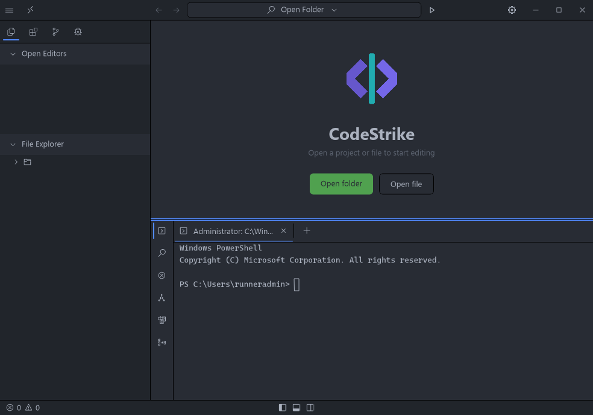
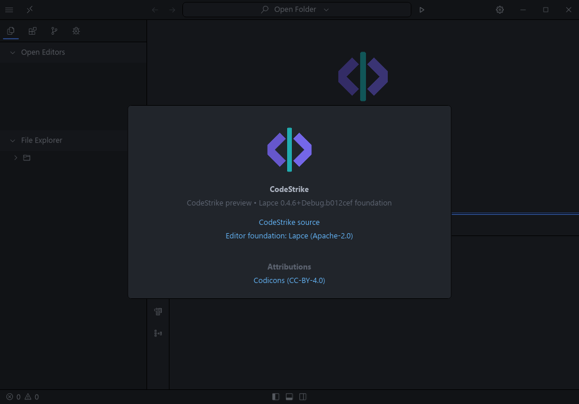
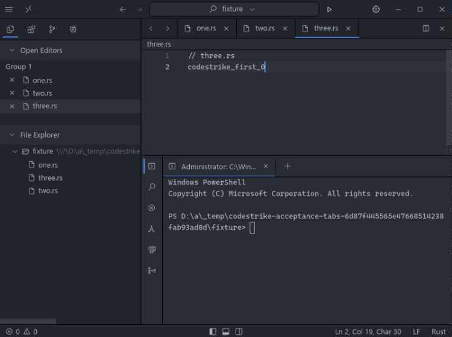
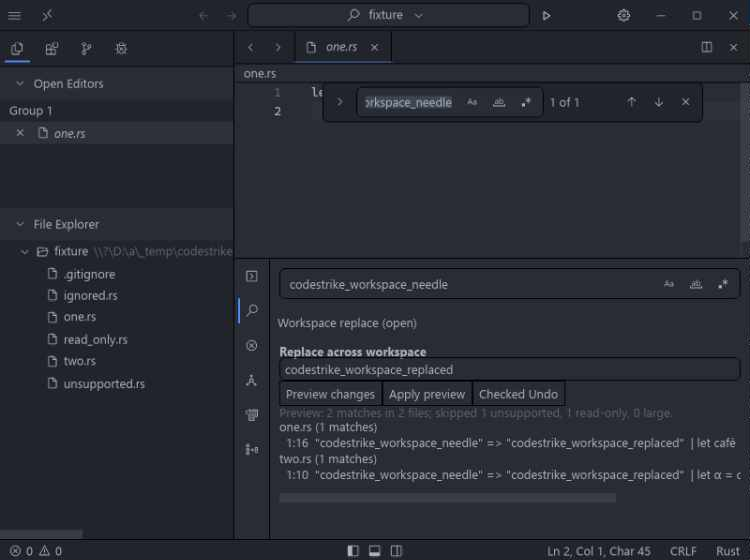

<p align="center">
  
</p>

<h1 align="center">CodeStrike</h1>

<p align="center"><strong>Stay close to your code.</strong><br>A local source editor for real folders, careful saves, and deliberate Rust workflows.</p>

<p align="center">
  <a href="https://prowebdevsolutions.com"><picture>
    <source media="(prefers-color-scheme: dark)" srcset="assets/branding/PWDS-logo-orange.svg">
    
  </picture></a>
</p>

> **Lapce-only engineering preview — source build only.** CodeStrike now uses the preserved, patched Lapce editor as its only application. The pre-Lapce desktop is retired. Existing Lapce customizations and analyzer work remain intact; this cutover does not claim DeltaDB integration, a new UI, an installer or a release.

<p align="center"><a href="#editor">Editor</a> | <a href="#build-and-run">Build and run</a> | <a href="#status-and-roadmap">Status</a> | <a href="#source-and-attribution">Attribution</a></p>



*Lapce-based branding candidate at [`e61517b`](https://github.com/Gerbzz/CodeStrike/commit/e61517b15f09f6860a06595fda44ca73c87f8d68), captured from a native Windows build. This candidate is developed in [PR #8](https://github.com/Gerbzz/CodeStrike/pull/8); it predates this Lapce-only routing change and is not a released build. [Capture provenance and limits](docs/NATIVE_BRANDING_CAPTURES.md).*

## Editor

CodeStrike is the [pinned Lapce-based editor](editor/UPSTREAM.md), with the existing CodeStrike patch, guarded-save and workspace replacement improvements. It is not a new editor rewrite. The retained images document their original source revisions, not fresh acceptance of every subsequent commit.



*Native startup and About at commit `e61517b15f09f6860a06595fda44ca73c87f8d68`, captured by [run 39693959159](https://github.com/Gerbzz/CodeStrike/actions/runs/39693959159). The captures contain an empty editor and idle runner terminal, not a user project. They establish appearance for that candidate build, not editing, language-tool, taskbar or installed-app acceptance. [Original bytes, hashes and checks](docs/NATIVE_BRANDING_CAPTURES.md).*

The candidate still needs crash-interruption and cross-session recovery tests, automatic cleanup of visible backups, broader search/replace cases, current-head language-tool verification, accessibility review, and clean-machine installation. It is not yet a distribution.

<details>
<summary>Historical candidate workflow screenshots</summary>

These earlier images record specific tab/search/replace tests. They remain useful test evidence, but are not the current visual showcase or fresh acceptance of the branding candidate.

### Real tabs and a restorable session

Three distinct source files were edited and saved, the app closed, and the same tabs reopened for further edits in the [Windows acceptance run](https://github.com/Gerbzz/CodeStrike/actions/runs/38757901744). Workspace search opened a clicked hit at its UTF-8 byte column. Per-file Replace All and save-conflict protection were also exercised.



*Historical Lapce-based CodeStrike capture. [Full original capture and crop provenance](docs/CANDIDATE_SCREENSHOTS.md).*

### Preview a workspace change before writing

The editor candidate has a bounded multi-file replacement flow: preview paths, positions, context, and replacement text; confirm Apply; use Checked Undo while the session is open. The Windows GUI probe previewed two files without changing them, refused an Apply after an external edit, applied two replacements while preserving UTF-8 BOM/CRLF and LF bytes, refused Undo over a newer edit, and then restored the originals exactly. Ignored, read-only, and unsupported files were not changed.



*Historical Lapce-based CodeStrike capture. [The checked Undo app-window crop](assets/screenshots/codestrike-candidate-undo-app.png) and [full original captures with hashes](docs/CANDIDATE_SCREENSHOTS.md) show the rest of this bounded test.*

</details>

## Build and run

### Windows source build

The candidate has its own pinned Lapce submodule and patch. On Windows, start with a fresh checkout and enough disk space for a Rust GUI build:

```powershell
git -c core.autocrlf=false clone --recurse-submodules https://github.com/Gerbzz/CodeStrike.git CodeStrike
cd CodeStrike
pwsh -File .\scripts\build-codestrike.ps1
Copy-Item .\editor\lapce\target\debug\lapce.exe .\editor\lapce\target\debug\CodeStrike.exe
.\editor\lapce\target\debug\CodeStrike.exe --wait
```

This follows the [tested Windows workflow](.github/workflows/editor-candidate.yml); it is a developer build, not an installer. The latest full acceptance run measured a 103.75 MiB debug executable, but release and installed footprints have not been measured. If a checkout converts the pinned upstream source to CRLF, the patch preparation will refuse it; use a fresh LF checkout rather than applying the patch to modified files.

### Explicit reviewed Rust language-server selection

The supported development route uses the preserved reviewed analyzer source, not an
implicitly discovered stock server. It is **not bundled or installed by the editor
build**. Stock rustup rust-analyzer 1.99.1 (`58cf8f9c`) has an inverted semantic
readiness check: diagnostics can disappear once build data/proc macros finish
loading. The existing reviewed patch repairs that guard and its reload regression;
this does not claim to repair an independently installed stock binary.

From the CodeStrike source checkout, build a fresh pinned analyzer checkout:

```powershell
rustup toolchain install 1.97.1 --profile minimal --component rust-src --no-self-update
git -c core.autocrlf=false clone https://github.com/rust-lang/rust-analyzer.git reviewed-analyzer-source
git -C reviewed-analyzer-source checkout --detach a0b58c0fe3e924302c1155e88c4a9454f86280c2
pwsh -File .\scripts\analyzer\build-reviewed-analyzer.ps1 -SourcePath reviewed-analyzer-source -TargetDirectory reviewed-analyzer-target
```

The command verifies the exact compiler, upstream commit, original patch and lockfile
hashes; it refuses dirty sources, builds without test hooks, runs library regressions,
and prints the selected executable's version/path/SHA-256. Reuse the resulting binary;
do not rerun patch preparation over modified source.

Build the same pinned Rust Volt used by the native acceptance workflow:

```powershell
rustup target add wasm32-wasip1
git clone https://github.com/lapce/lapce-rust.git rust-volt-source
git -C rust-volt-source checkout --detach ea1c8da7df318a253edf07bd2862d236951b6d80
cargo build --manifest-path rust-volt-source/Cargo.toml --locked --release --target wasm32-wasip1 --target-dir rust-volt-source/target
New-Item -ItemType Directory -Path reviewed-rust-volt -Force
Copy-Item rust-volt-source/target/wasm32-wasip1/release/lapce-rust.wasm reviewed-rust-volt
Copy-Item rust-volt-source/volt.toml,rust-volt-source/LICENSE,rust-volt-source/rust-logo.png reviewed-rust-volt
```

In the workspace's `.codestrike/settings.toml`, explicitly select your built binary
using an absolute path (merge this section with existing settings; do not overwrite them):

```toml
[lapce-rust]
serverPath = 'C:\path\to\CodeStrike\reviewed-analyzer-target\debug\rust-analyzer.exe'
```

Launch the editor with `--plugin-path C:\path\to\CodeStrike\reviewed-rust-volt`
and your workspace path. This is the real Volt `serverPath` selection also exercised
by all three required native language probes, which retain exact UTF-8 completion
and E0308 assertions. No global settings are changed, no prebuilt analyzer is downloaded,
and default bundling/installer acceptance remains unfinished.

## Status and roadmap

| Area | Lapce-based CodeStrike |
| --- | --- |
| Files, tabs, search and replacement | Existing candidate implementation preserved; exact historical test evidence below and in the acceptance matrix |
| Language tooling | Reviewed analyzer source and probes preserved; packaging and current-head acceptance remain separate gates |
| Delta/DeltaDB and collaboration | Existing agent donor branch preserved; integration and licensing verification are separate work, not delivered by this cutover |
| Distribution | Source build only; no installer or release |

`cargo run --locked --bin codestrike -- <editor arguments>` delegates only to the prepared debug Lapce executable. It fails clearly if that executable has not been built. Set `CODESTRIKE_EDITOR` to an explicit release/custom build path if needed. Arguments are passed directly, never through a shell.

The root Rust library remains a tested developer support component, not another editor. Its preserved CLI is explicitly named `codestrike-core-tool` (`cargo run --locked --bin codestrike-core-tool -- ...`). See [cutover and preservation audit](docs/migration/LAPCE_ONLY.md).

The [candidate acceptance matrix](docs/migration/ACCEPTANCE.md) records the tested cases and open gates. CodeStrike is still an engineering preview, not a VS Code replacement ready for everyday professional work.

## Source and attribution

The original CodeStrike and PWDS artwork above is retained. [Brand provenance](assets/branding/provenance.json) and [default-editor screenshot provenance](docs/SCREENSHOT_PROVENANCE.md) identify those assets. The editor candidate is based on pinned [Lapce v0.4.6](https://github.com/lapce/lapce/releases/tag/v0.4.6) under Apache-2.0; its license and source history remain in the submodule. [`THIRD_PARTY.md`](THIRD_PARTY.md) records the dependencies and donor audit and retained support library.

No first-party license grant is stated for this checkout. Binary distribution would need notices verified against its exact contents.
