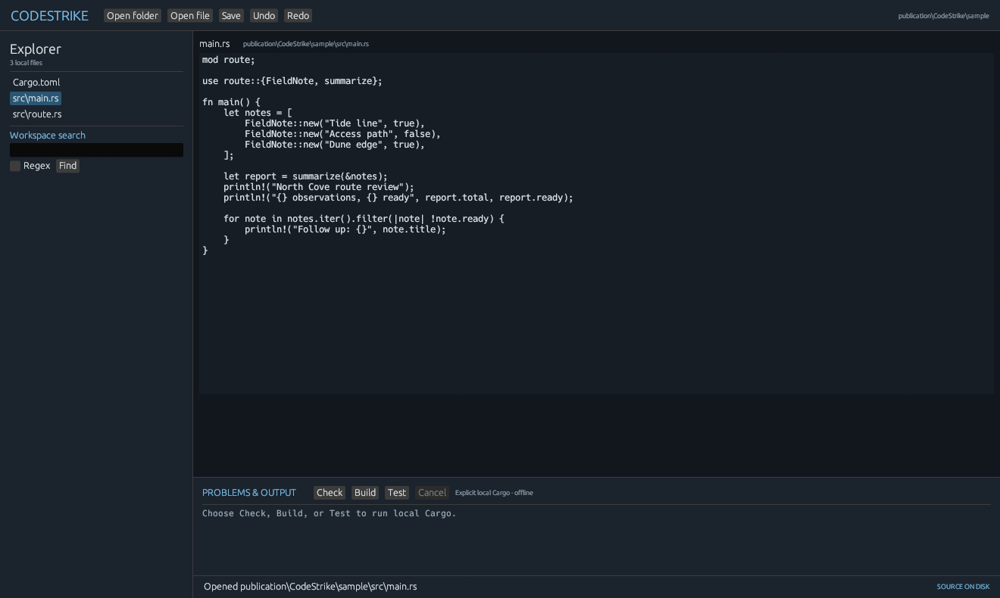

<p align="center">
  
</p>

<h1 align="center">CodeStrike</h1>

<p align="center">
  <a href="https://prowebdevsolutions.com"><picture>
    <source media="(prefers-color-scheme: dark)" srcset="assets/branding/PWDS-logo-orange.svg">
    
  </picture></a>
</p>

<p align="center"><strong>Stay close to your code.</strong></p>

CodeStrike brings a folder, its source files, and local Rust checks into one editor. Open a UTF-8 file, make a change, search the workspace, and run Cargo Check, Build, or Test when you choose.



*The retained Windows desktop editor rendering a self-authored, three-file Rust sample. Build, Check, and Test are visible controls; none were run for this capture.*

<p align="center"><a href="#highlights">Highlights</a> · <a href="#build-and-use">Build and use</a> · <a href="assets/branding">Original artwork</a></p>

## Highlights

- Edit and save local source with recovery safeguards.
- Search files in a selected workspace.
- Read diagnostics and output from explicit Cargo commands.

## Current status

Windows engineering preview. The native editor is limited to one active file and does not yet have syntax coloring, a debugger, or an accessibility pass. Cargo checks may execute build scripts from the selected project; review that project before running them.

[Screenshot provenance](docs/SCREENSHOT_PROVENANCE.md) records the retained binary, matched source, self-authored sample, and capture limits.

## A guarded editing path

The editor shows the chosen workspace, active file, dirty state, search results, diagnostics, and command output. It preserves a file's BOM and consistent newline style, checks for outside changes before saving, and writes a recovery snapshot after edits. Cargo commands run only when explicitly selected; they may execute that workspace's build scripts and procedural macros.

## Build and use

Launch on Windows from this directory:

```powershell
$env:CARGO_BUILD_JOBS='1'
$env:CARGO_TARGET_DIR='..\target-codestrike'
cargo test --locked --features desktop
cargo run --locked --features desktop --bin codestrike-desktop
```

A fresh checkout needs registry access for its first dependency download. After the registry cache is populated, add `--offline` if an offline build is needed.

Choose **Open folder**, then select a file in Explorer or use **Open file**. Edit directly; a recovery snapshot is written after changes, and Ctrl+S or **Save** updates the source after checking its disk version. **Undo/Redo** uses the source model; a found search result opens its file. Check/Build/Test display the exact local Cargo argv and workspace cwd and run only when pressed. Cargo may execute the selected workspace's build scripts and procedural macros. `--workspace PATH --file PATH --capture FILE.png` is an app-rendered QA capture path.

Command line source workflow:

```text
cargo run --locked --bin codestrike -- status path/to/main.rs
cargo run --locked --bin codestrike -- insert path/to/main.rs 0 "// note"
cargo run --locked --bin codestrike -- find path/to/workspace symbol
cargo run --locked --bin codestrike -- check path/to/cargo-workspace
```

`replace`, `regex`, `recover`, `build`, and `test` are also available. Indexes and search columns count Unicode scalar values. Invalid UTF-8, binary/NUL, mixed newline, and files over 20 MiB open read-only. Search examines at most 100 MiB and returns at most 500 hits. Cargo uses `--offline` and no shell interpolation; checking a selected project may still execute that project's build scripts or proc macros, as normal Cargo does.

Current limits: one active file, no syntax colors or line-number gutter, result-to-caret navigation, replace preview, rust-analyzer, debug adapter, or accessibility pass. Cargo runs off the UI thread with a Cancel control, ten-minute timeout, and 4 MiB capture cap per output stream. Windows runs the command in its own kill-on-close Job Object; a controlled fake Cargo child and a real Cargo build-script child were both stopped on cancellation. Non-Windows process execution currently refuses to start until equivalent lifecycle cleanup is tested. Source and recovery writes use exclusive transaction files and refuse changed recovery/source content; existing sidecars are preserved. Search bounds and file refusal remain as described above. The pinned VectorCraft UI donor's palette/dock code depends on its illustration engine and egui 0.36; no code from that UI has been copied. Windows is the only tested platform. Planning history and QA captures are not included in this standalone source checkout.

## Source terms

No first-party license grant is stated for this app in this checkout. `THIRD_PARTY.md` records attribution for identified upstream material; the included donor license files, where present, apply to that material.

## PWDS brand artwork

The company mark in this masthead is the existing [official PWDS logo](https://github.com/Gerbzz/PWDS-Website/blob/main/public/prowebdevsolutions-logo.png), with the [official orange display asset](https://prowebdevsolutions.com/images/prowebdevsolutions-logo-orange.svg) for dark backgrounds. Any app logo above it remains the original Strike suite artwork.
